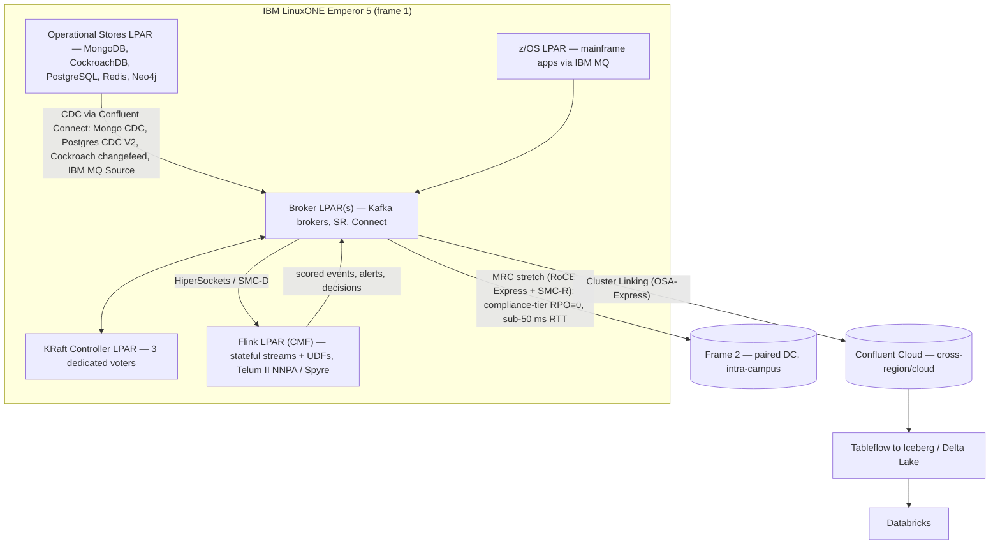

# FSI Reference Architecture — LinuxONE Operational Plane + Off-Platform Analytics

## Summary

Reference architecture for FSI workloads that pins the **operational data plane** to IBM LinuxONE Emperor 5 — the L1-certified data stores (MongoDB, CockroachDB, PostgreSQL, Redis, Neo4j, Confluent Platform) plus Confluent Manager for Apache Flink — and routes the **analytical plane** off-platform to Databricks via Confluent Cluster Linking. Confluent is the universal nervous system: every state change in every operational store flows as an event onto Kafka, and every analytical workload reads from Kafka or its tiered-storage cold object copy. Telum II provides on-chip AI inference for sub-ms decisioning; Spyre (where present) covers larger model classes. DR is multi-frame Cluster Linking. Off-platform analytics never read directly from L1 stores — they consume the event stream.

> Why this shape: every store named is L1-certified, which means a single hardware footprint with hardware crypto (CPACF, CEX8S), in-frame networking, and shared operational tooling. One exception: CP FIPS mode is not yet supported on s390x, so a broker tier whose policy mandates FIPS 140 validated crypto runs on x86/ARM, not L1. The analytical plane needs elastic compute and access to non-FSI data (market feeds, vendor enrichment), which Databricks delivers better than any on-frame option. Splitting at the operational/analytical boundary is the natural seam.

## Pattern

### 1. Topology

**Two distinct DR / replication mechanisms — they are not interchangeable:**

- **Multi-Region Clusters (MRC)** — single logical cluster stretched across frames within the same data center, synchronous quorum + observers (`replica.selector.class=...RackAwareReplicaSelector`). Achieves **RPO=0** for compliance-tier topics if inter-frame RTT stays inside the latency budget (~50 ms p99 ceiling for sane producer p99). Cross-frame transport is RoCE Express + SMC-R; see [LinuxONE Platform Foundations § Cross-frame Transport](../concepts/linuxone-platform-foundations.md). For dual-frame timing across the MRC stretch you need [STP-coordinated time](../concepts/linuxone-platform-foundations.md#server-time-protocol) (the regulator's third question).
- **Cluster Linking (CL)** — two independent clusters, asynchronous mirror. RPO bounded by link lag; **never zero**. Right tool for off-platform mirroring (CC, Databricks) and inter-DC / inter-cloud topologies.

> **If your paired DC is geographically separated** (>50 ms RTT, e.g. cross-region), you cannot use MRC — accept bounded-but-nonzero RPO via async CL. The choice is between strict-RPO (intra-DC MRC) and geographic redundancy (inter-DC CL); you cannot have both with the operational stack alone. Layer store-native replication (Cockroach `survive=region`, Mongo replica set) for SoR survival underneath either choice.

### 2. Roles and Sizing

| Component | Role | L1 sizing (per frame) | Notes |
|-----------|------|------------------------|-------|
| **Confluent Platform** | Event nervous system | 6 brokers + 3 KRaft controllers | KRaft only (CP 8.0+); see [LinuxONE Kafka Tuning](linuxone-kafka-tuning.md) |
| **CMF (Flink)** | Stateful processing, AI inference | 4 TaskManagers, 16 slots each | Telum II UDFs for sub-ms decisioning |
| **MongoDB** | Document store for customer / account profiles | Replica set, 3 members in-frame, 2 cross-frame | WiredTiger; ensure `s390x` tarball |
| **CockroachDB** | OLTP for ledger / payments | 3-node cluster, locality-aware replication | Multi-region across the two frames; `survive=region` for `critical` tier |
| **PostgreSQL** | Transactional / analytical hybrid | 1 primary + 2 replicas per frame | Logical replication for CDC into Kafka |
| **Redis** | Hot cache, session, rate limiting | 3-master + 3-replica cluster | Redis Enterprise on s390x certified |
| **Neo4j** | Entity / fraud graph | 3-node causal cluster | Aura on L1 not GA; self-managed Enterprise |
| **IBM Cloud Object Storage** | Tiered storage target, model artifacts | Off-LPAR, on-frame | S3-compatible for Confluent Tiered Storage and Flink checkpoints |
| **Databricks** | Lakehouse, ML training, BI | Off-platform (AWS / Azure / GCP) | Receives Iceberg/Delta Lake topics via Tableflow / Confluent Cloud |

### 3. Data Flow Patterns

#### 3.1 Operational Write → Event Stream
Every operational store emits CDC into Kafka via a **Confluent-supported connector** — first-party connector from Confluent Hub or a partner-published connector that Confluent supports. Avoid Debezium-direct or community connectors here: the IBM Confluent Platform for Z and LinuxONE bundle gives single-vendor support across the broker + connector lifecycle, and FSI audit prefers a single throat to choke.

| Source | Connector (Confluent-supported) | Mechanism | Topic naming |
|--------|----------------------------------|-----------|--------------|
| MongoDB | **MongoDB CDC Source (Debezium)** (Confluent-managed in CC); **MongoDB Atlas Source/Sink** also fully-managed | MongoDB change streams | `cust.profile.changed.v1` |
| CockroachDB | **CockroachDB CDC Connector** on Confluent Hub (self-managed only — not in CC fully-managed catalog as of 2026-05). Underlying mechanism is Cockroach's native changefeed sinking directly to Kafka | Native CockroachDB changefeed → Kafka | `ledger.transaction.posted.v1` |
| PostgreSQL | **PostgreSQL CDC Source V2 (Debezium)** (Confluent-managed in CC). V1 reached EOL **2026-03-31** — migrate any V1 instances | Logical replication via `pgoutput` | `accounts.balance.updated.v1` |
| Redis | No source connector — cache is derived state, not source of truth. Use the **Redis Sink** to *materialize* into Redis, not the reverse | n/a | n/a |
| Neo4j | **Neo4j Sink** (Confluent-managed in CC) + **Neo4j Connector for Confluent and Apache Kafka** v5.1+ (by Neo4j; certified on Hub for source/CDC; CDC source requires Neo4j Enterprise / Aura with CDC enabled) | Neo4j CDC stream | `fraud.entity.linked.v1` |
| z/OS | **IBM MQ Source** (Confluent-managed in CC; also self-managed on Hub) — see [LinuxONE Kafka Integration](concepts/linuxone-kafka-integration.md) | MQ queue → Kafka topic | `mainframe.txn.recorded.v1` |

All topics governed per [SLA Tiers](concepts/sla-tiers.md): tier-driven defaults for partitions, retention, compatibility, RBAC, and DR.

> **Why not Debezium-direct?** Debezium is the OSS upstream that several Confluent connectors are built on (PostgreSQL CDC, SQL Server CDC, MySQL CDC). Running Debezium direct gives you the same engine without the Confluent support contract, certification, or governance hooks — and **without Schema Registry integration**, which is a hard FSI governance hook for schema evolution and compatibility enforcement. The Confluent-packaged variant on Confluent Hub gives you all three. In FSI on the IBM L1 bundle, that's the wrong trade.

#### 3.2 Real-Time Decisioning (the L1 differentiator)
Flink jobs co-resident on L1 consume events, enrich via lookup joins to PostgreSQL or Redis (over HiperSockets), and call **Telum II NNPA** for sub-ms inference. Decisions land back on Kafka:

- `kafka.fraud.alerts.v1` → ops console, downstream block actions
- `kafka.events.scored.v1` → audit trail, ML retraining feed

See [LinuxONE Flink Validation & Tuning § Telum II Sub-Millisecond Anomaly Detection](linuxone-flink-validation-tuning.md).

#### 3.3 Off-Platform Analytics (Databricks)
**Cluster Linking** replicates governed topics from the on-frame Confluent Platform cluster to a Confluent Cloud cluster co-located with the Databricks workspace:

1. CL mirrors selected topics (no `auto.create.mirror.topics.enable`; explicit topic-by-topic).
2. CC's **Tableflow** materializes those topics as **Apache Iceberg or Delta Lake** tables in the analytical bucket — Tableflow supports both open table formats per Confluent's product brief.
3. Databricks reads via Unity Catalog (Delta Lake native; Iceberg via Uniform / Iceberg-REST).

This means:
- **No direct connection** from Databricks to L1 operational stores (security boundary).
- **Schema continuity** — same Avro/Protobuf schemas govern Iceberg tables; schema evolution flows through.
- **Replay** — Databricks ML training reads from Iceberg/Delta Lake cold storage; live features read via Kafka client.
- **Cost split** — L1 carries the durable transactional & decisioning load; Databricks carries the elastic analytical load. Each is best-fit.

#### 3.4 Off-Platform Targets Beyond Databricks
Same Tableflow pattern fans out to additional analytical destinations without re-reading the source-of-truth stores:

| Target | Use |
|--------|-----|
| **Databricks** | Lakehouse, ML training, ad-hoc analytics |
| **Snowflake** | Reporting, BI, regulatory submissions |
| **AWS S3 + Athena** | Long-term archive, on-demand queries |
| **Splunk / Dynatrace / Datadog** | Observability ([Audit Log SIEM Integration](audit-log-siem-integration.md)) |

### 4. Governance & Security

- **Schema Registry** is the canonical contract; all CDC connectors register Avro/Protobuf schemas; `compatibility.level` per tier.
- **RBAC** — service accounts per app, never per team; topic prefixes derived from [Topic Naming](topic-naming.md). MDS/RBAC on the L1 cluster; Confluent Cloud RBAC on the analytical mirror.
- **mTLS + OAUTHBEARER** end-to-end. CP FIPS mode is not yet supported on s390x (CP versions-interoperability, re-checked 2026-10-25): FIPS-mandated broker tiers run on x86/ARM.
- **Audit log** — the audit consumer reads the **on-frame Confluent audit topic**, NOT the CL mirror in CC, to avoid inheriting CL lag into the security-event pipeline. (A 30-second link lag means a 30-second blind spot for the SOC; compliance reviewers will not accept that.) The SIEM contract is "every denial captured within 30 s" per [LinuxONE Validation Suite §3.2](linuxone-validation-suite.md). Forwarding mechanism is the [Audit Log SIEM Integration](audit-log-siem-integration.md) pattern. CC audit log is a separate, additional feed for CC-side events.
- **Data residency** — operational data physically stays on the customer's L1 frames; only mirrored topics leave the perimeter. Per-topic mirror policy = governance hook for residency rules (e.g., EU customer data: do not mirror).

### 5. SLA Tier Mapping

| Workload | Stores | Tier | DR Target |
|----------|--------|------|-----------|
| Real-time payments | CockroachDB + Confluent + Flink | `critical` | **SoR (Cockroach `survive=region`): RPO=0** at the SQL layer (Raft groups span frames). **Derived events (alerts, scored events) on CL: RPO < 5 min** bounded by link lag. SoR survives a frame loss intact; downstream pipelines lose link-lag worth of records. Source-of-truth replays through the operational store after recovery. |
| Fraud / AML decisioning | Neo4j + Redis + Confluent + Flink (NNPA) | `critical` | RPO < 5 min for derived signals; Neo4j causal cluster preserves graph SoR |
| Regulatory reporting | PostgreSQL + Confluent (Tiered Storage to COS) | `compliance` | RPO = 0 via MRC on CP **intra-DC only** (sub-50 ms RTT). For geographically separated DR, accept bounded RPO via async CL — make the choice explicit in the SOW |
| Customer profile / CRM | MongoDB | `standard` | RPO < 2 hr |
| Audit trail | Confluent compacted topics + Iceberg/Delta Lake | `compliance` | RPO = 0; infinite retention |

### MCP Validation Notes

| Claim | Source | Result |
|-------|--------|--------|
| MongoDB CDC Source (Debezium) is Confluent-managed in CC | confluent-docs CC connectors index | Confirmed |
| PostgreSQL CDC Source V2 (Debezium) is Confluent-managed in CC | confluent-docs CC connectors index + V1 EOL page | Confirmed: V1 EOL 2026-03-31; "Confluent recommends migrating to PostgreSQL CDC Source V2 (Debezium)" |
| Neo4j Sink is Confluent-managed in CC | confluent-docs CC connectors index | Confirmed |
| IBM MQ Source is Confluent-managed in CC | confluent-docs CC connectors index | Confirmed |
| CockroachDB CDC Connector availability | confluent-docs CC connectors index | Corrected: NOT in CC fully-managed catalog. Hub self-managed entry exists (`confluent.io/hub/cockroachdb/cockroach-cdc`); native CockroachDB changefeed → Kafka is the canonical mechanism |
| Tableflow output formats | confluent-docs llms.txt + Tableflow overview | Corrected: "Apache Iceberg™ and Delta Lake" — not Iceberg only |
| Analytics & ML | Databricks (off-platform) | `best-effort` (analytical replica) | Re-derivable from CL + Iceberg |

### 6. Why This Shape Works for FSI

- **One frame** — operational data, encryption, decisioning, and DR are all inside the same hardware and audit boundary. The exception is a tier whose policy mandates FIPS 140 validated broker crypto: CP FIPS mode is not yet supported on s390x.
- **Sub-ms decisioning** — Telum II in-process inference is unmatched on x86 because the network hop alone breaks the budget.
- **Vendor positioning** — IBM acquired Confluent (2026); the L1 + CP combination is now first-party, with IBM's "Confluent Platform for Z and LinuxONE" bundle.
- **Off-platform elasticity for analytics** — Databricks elastic compute, lakehouse format, MLOps maturity, and access to vendor data make it the right analytical home; pinning it to L1 would waste both the platform's strengths and L1's silicon.
- **Replayable from one source of truth** — Kafka Tiered Storage to IBM COS is the long-term immutable log; everything downstream (Iceberg, Databricks, Snowflake) is reproducible.

### 7. Anti-Patterns

- **Direct Databricks-to-operational-store JDBC pulls.** Breaks the audit boundary, blows the residency story, hammers OLTP locks. Always go through the event stream.
- **Mirroring all topics by default.** Use explicit topic policy; default to *not* mirroring sensitive PII unless residency rules permit.
- **Running combined-mode KRaft (controller + broker on same node).** Forbidden in production validation; see [LinuxONE Validation Suite §3.7](linuxone-validation-suite.md). The topology in §1 enforces this with a dedicated KRaft Controller LPAR.
- **Treating MRC and Cluster Linking as interchangeable.** MRC is your synchronous DR (compliance-tier RPO=0, intra-DC only). CL is your asynchronous mirror (analytical, off-platform, inter-DC). Don't let CL lag bleed into compliance-tier auditability — never run CL as the sole DR mechanism for a `compliance`-tier topic. (See §5 SLA Tier Mapping for the explicit boundary.)
- **Using Redis as a system of record.** Redis is hot cache and ephemeral state only — Cockroach or Postgres is the SoR.
- **Skipping in-frame networking.** If brokers and producers are on the same frame and traffic still leaves via OSA, tuning is wrong — see [LinuxONE Kafka Tuning §LinuxONE Overlay](linuxone-kafka-tuning.md).
- **Using OSA for cross-frame replication.** Cross-frame intra-DC traffic should use RoCE Express + SMC-R, not OSA. See [LinuxONE Platform Foundations § Cross-frame Transport](../concepts/linuxone-platform-foundations.md).
- **Off-platform AI for sub-ms decisioning.** GPU microservices over 10 GbE p99 at 5–15 ms; that misses the FSI `critical`/`market_data` tier targets entirely.

## Related

- [FSI Data Streaming Platform](concepts/fsi-data-streaming-platform.md) — the platform layer that this architecture deploys onto
- [LinuxONE Platform Foundations](../concepts/linuxone-platform-foundations.md) — STP, CBU, SMC-R, UKO key lifecycle, Telum/Spyre tiering, crun, IBM benchmark anchors that this architecture assumes
- [LinuxONE Kafka Integration](concepts/linuxone-kafka-integration.md) — the frame-level mainframe-bridge precedent
- [LinuxONE Validation Suite](linuxone-validation-suite.md) — how to prove this works
- [LinuxONE Kafka Tuning](linuxone-kafka-tuning.md) — operational tuning for the event plane
- [LinuxONE Flink Validation & Tuning](linuxone-flink-validation-tuning.md) — the AI decisioning layer
- [SLA Tiers](concepts/sla-tiers.md) — tier mapping driving every governance default
- [DR — Cluster Linking](dr-cluster-linking.md) — DR mechanism for the event plane
- [FSI Exactly-Once Pattern](fsi-exactly-once.md) — durability bar across the whole stack
- [Audit Log SIEM Integration](audit-log-siem-integration.md) — observability boundary
